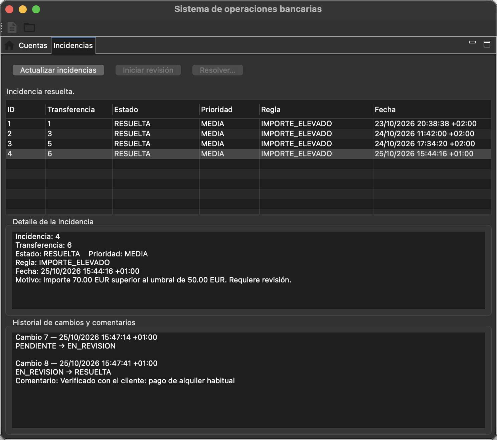
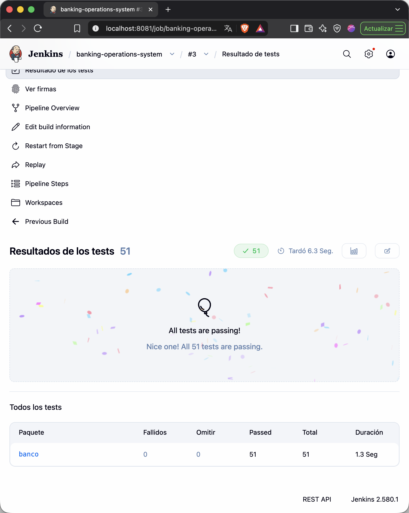

## Qué es

Una simulación del trabajo de back office de un banco: transferencias entre cuentas,
detección automática de operaciones sospechosas y gestión de las incidencias que
generan, con historial de cada cambio. Los empleados trabajan desde un cliente de
escritorio en Eclipse RCP que habla con una API REST en Spring Boot.

<video class="demo" controls muted playsinline preload="metadata" poster="/videos/countercheck-demo.jpg" aria-label="Demostración: una transferencia de 60 EUR genera una incidencia que el empleado revisa y resuelve">
	<source src="/videos/countercheck-demo.mp4" type="video/mp4" />
</video>

## Cómo funciona

Durante una transferencia, las dos cuentas se reservan para que ninguna otra operación
las modifique a la vez. Después se aplican las reglas de negocio, se guardan saldos y
movimiento, se evalúa la regla de detección y, si salta, se registra la incidencia. Todo se
confirma o se revierte junto: no puede existir una transferencia marcada sin su
incidencia, ni al revés.

Las incidencias siguen un flujo `PENDIENTE → EN_REVISION → RESUELTA`, con comentario
obligatorio al resolver e historial fechado de cada cambio de estado.

## Decisiones

- **SQL explícito con JDBC en vez de JPA**, para tener control total sobre las consultas
  y los bloqueos.
- **Bloqueo de filas en orden de ID**, que evita gastar dos veces el mismo saldo y
  previene interbloqueos entre transferencias cruzadas.
- **`BigDecimal` y `DECIMAL(19,2)`** para que no haya errores de redondeo en importes.
- **Cambios de estado condicionados al estado previo**, para que dos revisores
  simultáneos no apliquen la misma transición dos veces.

## Calidad

51 pruebas con JUnit 5 y MockMvc: reglas de negocio sin Spring, rutas y errores de la
API, SQL con rollback, transferencias concurrentes y persistencia tras reinicio. Jenkins
ejecuta las pruebas en cada cambio y archiva el JAR solo si todo pasa.

## Próximos pasos

Autenticación y roles con Spring Security, contenedor Docker y despliegue automático
desde Jenkins.
